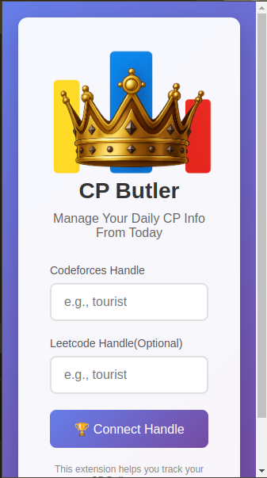
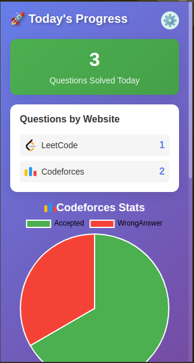

#  CP Butler

**CP Butler** is a powerful Chrome Extension built with **TypeScript + React** that helps Competitive Programmers stay on track by visualizing their daily progress across **Codeforces** and **LeetCode**.

Whether you're aiming to maintain a streak, monitor your submissions, or prepare for upcoming contests — CP Butler has your back.

---

## ✨ Features

- 📅 **Contest Calendar**  
  See upcoming Codeforces, LeetCode, CodeChef and AtCoder contests with a live countdown.

- 🔔 **Contest Reminders**  
  Get a notification before a contest starts. Choose the timing in Settings.

- 🔥 **Streak & Heatmap**  
  Track your solving streak and daily activity across Codeforces and LeetCode.

- 🧠 **Daily Solved Tracker (CF + LC)**  
  Know how many distinct questions you've solved **today** — combined across both Codeforces and LeetCode.

- 🔗 **Clickable Problems**  
  Open any solved or attempted problem on Codeforces or LeetCode with one click.

- ⚡ **Instant Loading**  
  Your last loaded data shows instantly when you open the extension, then refreshes in the background.

- 📊 **Codeforces Submission Analysis (Pie Chart)**  
  Visualize your recent Codeforces submissions (AC, WA etc.) with a clean pie chart.

- 🏆 **Recent Codeforces Contest Standing**  
  Instantly check your latest contest rank, rating change, and performance summary from your recent Codeforces participation. Click a contest to open its standings.

- ⚛️ **Built using React + TypeScript**  
  Modern architecture for fast UI and scalable code.

---

## 📦 Tech Stack

- 🧩 Chrome Extension APIs
- ⚛️ React
- 🟦 TypeScript
- 📡 Codeforces REST API
- 📡 LeetCode GraphQL API
- 📡 CodeChef contests API
- 🌐 AtCoder contests page
- 📊 Chart.js (for visual stats)

---

## 📋 Dashboard Summary

| Section                     | Description                                           |
|-----------------------------|-------------------------------------------------------|
| 🔹 Today's Stats            | Distinct problems solved on CF + LC (for today)       |
| 🔥 Streak & Heatmap         | Current / longest streak and last 20 weeks of activity |
| 🔸 Submission Pie Chart     | Verdict-wise distribution of Codeforces submissions   |
| 🟢 Contest Calendar         | CF, LC, CodeChef and AtCoder rounds with reminders    |
| 🟣 Recent CF Contest Result | Rank, rating change, and stats from your latest round |
| 🧠 LeetCode Tracker         | Problems solved today and their difficulty levels     |

---

## Screenshots





---

🎥 Demo Video

Watch the full demo of CP Butler in action 👇

📺 YouTube Link: https://youtu.be/QRyYwGxFTAI

---


## 🚀 Getting Started

### 1. Clone the repo

```bash
git clone https://github.com/KingAB2004/CP-Butler.git
cd CP-Butler
```

### 2. Install dependencies

```bash
npm install
```

### 3. Build the extension

```bash
npm run build
```

### 4. Load in Chrome

- Go to `chrome://extensions`
- Enable **Developer Mode**
- Click **Load Unpacked**
- Select the `dist` folder

---

## 🛡️ Privacy First

- No account login required  
- Your usernames/handles and cached stats are stored **locally** in your browser  
- No data is sent to any third-party server; the extension only reads public data from Codeforces, LeetCode, CodeChef and AtCoder
- LeetCode only shows your 20 most recent accepted submissions, so your LeetCode streak history builds up from the day you install the extension

---

## 🙌 Contributing

Feel free to contribute by opening issues or submitting pull requests.

### To Contribute:
1. Fork the repository  
2. Create a new branch `git checkout -b feature/amazing-feature`  
3. Make your changes  
4. Push and open a PR 🚀

---
## 📦 Releases

[](https://github.com/KingAB2004/CP-Butler/releases)

You can find the latest stable versions of this extension on the [Releases page](https://github.com/KingAB2004/CP-Butler/releases).

---
## 📄 License

This project is licensed under the MIT License.

---

## 📬 Contact

**Author**: [Arpit Bhomia]  
🔗 GitHub: [github.com/KingAB2004](https://github.com/KingAB2004)

---

> **CP Butler** — because tracking your CP journey should be as smart as your solutions 🧠💪
